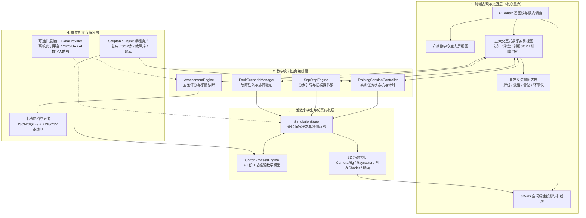
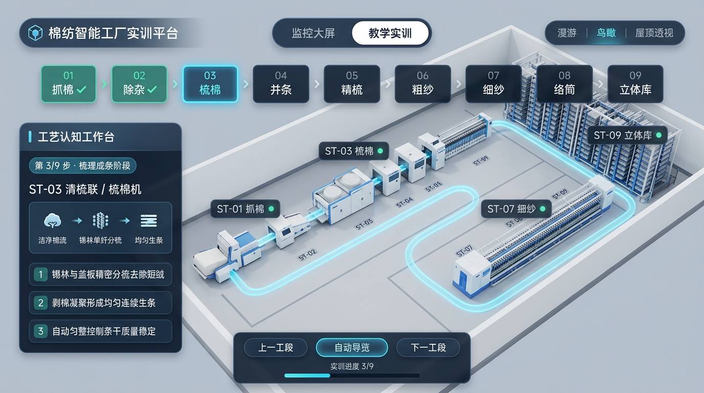
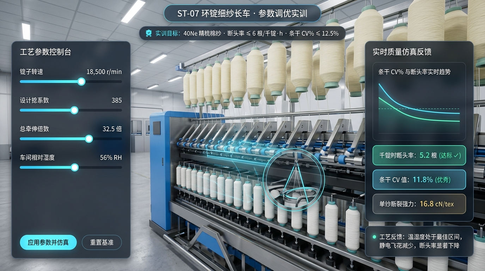
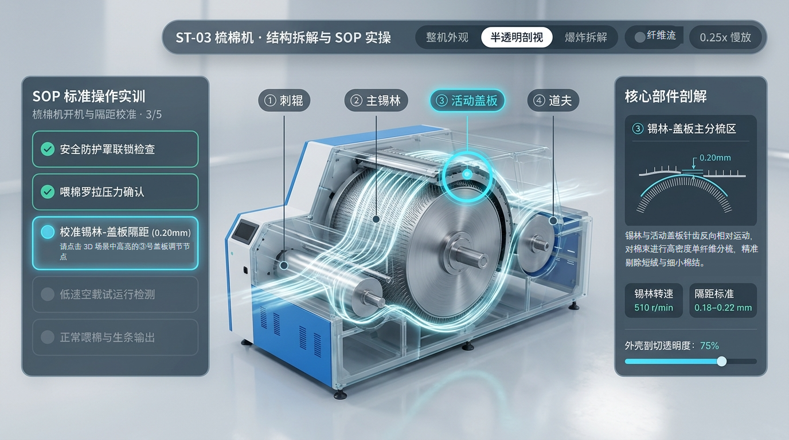
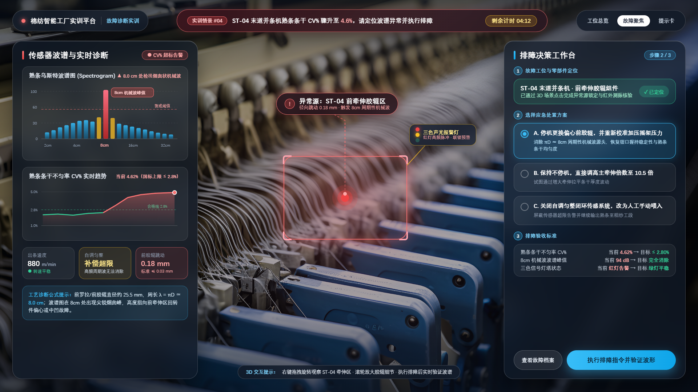
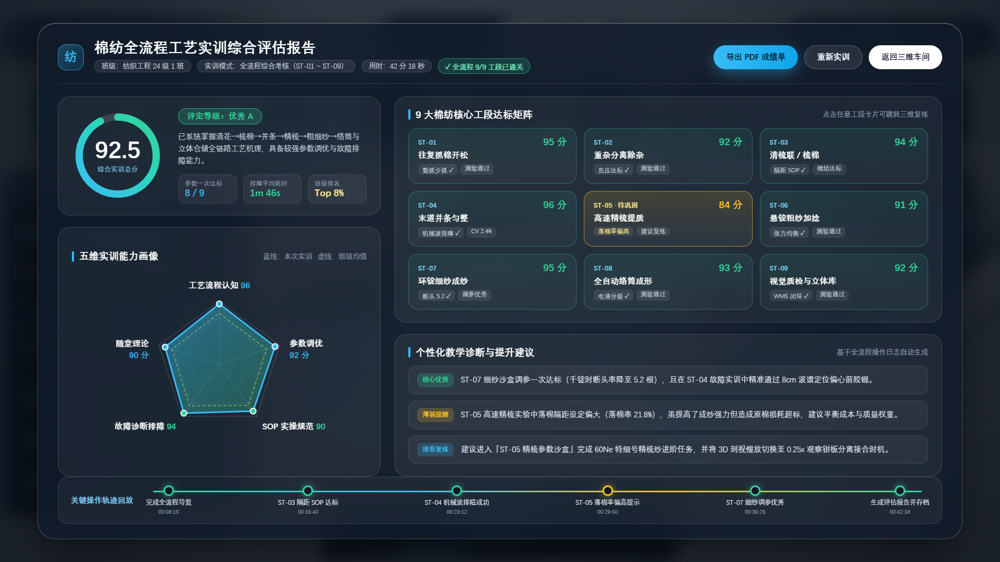

# 棉纺智能工厂三维数字孪生与交互式工艺实训平台 — 开发规划 (`plan.md`)

> 本规划基于现有 Unity 工程（`CNC`，Unity `2022.3.62f3` + URP `14.0.12` + UGUI + TextMeshPro）进行**渐进式演进**，保留已完成的双车间 3D 场景、9 大棉纺工段（`ST-01` ~ `ST-09`）资产与 Apple VisionOS Style A 磨砂玻璃视觉基因，重点将前端从“静态看板 + 简单导览”升级为**面向棉纺全流程教学实训的交互式实训平台**。

---

## 1. 现状基线与升级目标

### 1.1 现有工程已具备的基础能力
通过对现有工程源码的梳理，系统已完成第一阶段基础搭建：
- **双场景与 3D 资产**：启动场景 `Assets/Scenes/Play.unity` + 主车间场景 `Assets/Scenes/SampleScene.unity`（主纺纱车间 + 智能检测与立体仓储车间），已完成 URP 14 渲染管线、PBR 材质与 PhysX 碰撞加固。
- **9 大棉纺工段数据字典**：`Assets/_Project/Scripts/WorkshopCatalog.cs` 已定义 `ST-01` 往复抓棉 → `ST-02` 重杂分离除杂 → `ST-03` 清梳联/梳棉 → `ST-04` 末道并条 → `ST-05` 高速精梳 → `ST-06` 悬锭粗纱 → `ST-07` 环锭细纱 → `ST-08` 全自动络筒 → `ST-09` 视觉质检与立体库的基础工艺文案、设备参数与 1 道随堂单选题。
- **核心三维交互与视觉风格**：`CameraRigManager.cs`（第一人称漫游 / 鸟瞰全景 / 工位聚焦 / 自动巡检 + 屋顶透视）、`MachineRaycaster.cs`（Fresnel 轮廓高亮）、`WorldStationMarker.cs`（3D 空间铭牌）、Style A 磨砂玻璃 9 宫格贴图与 72pt Noto Sans SC SDF 字体。

### 1.2 面向“交互式工艺实训”的核心缺口（本阶段改造重点）
| 维度 | 现有状态 (V1.0) | 目标实训平台 (V2.0) |
| :--- | :--- | :--- |
| **前端架构** | `DigitalTwinHUD.cs` 为 826 行单体脚本，UI 由 `Step3_BuildFrontendScenes.cs` 过程式硬编码生成，难以扩展复杂实训面板 | 拆分为 **MVP 模块化 UI 架构 + Prefab 组件库 + `UIRouter` 视图栈 + 动静 Canvas 分层** |
| **教学交互深度** | 以“看文字 + 启停开关 + 单题测验”为主，缺乏动手工艺实验闭环 | 构建 **工艺认知导览 → 参数调优沙盒 → 3D 剖视 SOP 实操 → 故障波谱排障 → 五维评估报告** 完整实训闭环 |
| **数据可视化** | 仅包含静态数值文本、简单进度条和 16 宫格货位色块 | 内置零重依赖高性能矢量图表：**实时趋势折线图、乌斯特波谱柱图、五维能力雷达图、环形得分仪** |
| **教学闭环管理** | 仅内存级布尔标记（`stationLearned` / `stationQuizPassed`），关闭即丢失 | 本地持久化实训档案（JSON/SQLite）、操作轨迹回放、五维自动评分与 PDF/CSV 成绩单导出 |

---

## 2. 总体系统框架设计（大致实现思路）

平台采用**“四层解耦 + 事件驱动 + 单机优先/扩展就绪”**的 Windows 桌面端架构，确保在高校机房/无外网实训室开箱即用，同时为后续接入真实车间数据或 AI 助教预留清晰边界。



### 核心目录重构规划（基于 `Assets/_Project/` 渐进演进）
```text
Assets/_Project/
├── Configs/                     # ScriptableObject 教学内容资产（非程序员/教师可配）
│   ├── WorkshopCatalog.asset    # 9 工段基础工艺与设备规格（复用扩展）
│   ├── SandboxPresetCatalog/    # 各工段参数范围、基准值、实训达标任务
│   ├── SopTaskCatalog/          # SOP 分步流程与 3D 交互锚点配置
│   └── FaultScenarioCatalog/    # 典型棉纺故障情景、波谱特征与处置方案
├── Prefabs/UI/                  # 【新增】模块化 UGUI 预制体组件库
│   ├── Atoms/                   # 胶囊按钮、参数滑块、状态徽章、指标卡片、矢量图表
│   ├── Views/                   # 五大实训主视图与监控大屏视图 Prefab
│   └── WorldSpace/              # 3D 工位铭牌、部件序号气泡、故障告警标签
├── Scripts/
│   ├── Core/                    # EventBus、AppLaunchContext、ServiceLocator
│   ├── Simulation/              # SimulationState、CottonProcessEngine（工艺模型）
│   ├── Training/                # TrainingSession、SopEngine、FaultManager、AssessmentEngine
│   ├── Twin3D/                  # CameraRigManager、MachineRaycaster、CutawayController、MaterialFlowController
│   └── UI/                      # 【前端核心重构目录】
│       ├── Framework/           # UIRouter、BaseView、UIThemeConfig、UIAnimator
│       ├── Charts/              # UILineChart、UISpectrogramBars、UIRadarChart、UIRadialGauge
│       ├── Spatial/             # WorldAnchorProjector、SpatialLeaderLine
│       ├── Dashboard/           # DashboardPresenter + View
│       └── Teaching/            # 5大教学实训 Presenter + View
└── Shaders/                     # 复用 Highlight/EmissiveFlow + 新增 XRayCutaway / MaterialStream
```

---

## 3. 前端架构与实现方案（核心重点）

### 3.1 Unity 前端技术选型与架构重构

1. **为什么坚持 UGUI + TextMeshPro（而非重写为 UI Toolkit）**
   - 现有工程已经完成高质量的 **72pt Noto Sans SC SDF 字体** 与 **Style A 9 宫格胶囊/磨砂玻璃精灵资源**，且 UGUI 对 WorldSpace 3D 空间铭牌、自定义 `MaskableGraphic` 矢量图表、Unity Shader 材质特效支持最成熟。
   - **关键改进**：停止用千行 Editor 代码拼接完整场景 UI，改为**“原子控件 Prefab + 视图 Prefab + 主题 `UIThemeConfig` 资产”**工作流，既支持直观所见即所得调整，也能保留一键校验脚本验证绑定完整性。

2. **从单体 HUD 迁移为 MVP（Model-View-Presenter）+ 视图路由栈**
   - 将现有 826 行 `DigitalTwinHUD.cs` 拆分为：
     - **`UIRouter`**：管理全局顶栏、实训模式切换（`Dashboard` / `Overview` / `ParamSandbox` / `CutawaySOP` / `FaultDiagnosis` / `AssessmentReport`）以及弹窗栈（设置 / 帮助 / 退出 / 成绩单），保证同一时刻仅激活当前模式视图，避免面板重叠遮挡。
     - **`View`（纯表现层）**：仅持有 UI 引用与轻量动画方法（如 `SetMetric(float val, bool passed)`），不含任何工艺计算或状态判断逻辑。
     - **`Presenter`（交互协调层）**：订阅 `SimulationState` 与 `TrainingSessionController` 事件，将用户滑块/按钮输入转为标准指令（Command），并将仿真结果推送给 View。

3. **桌面端高性能 4 层 Canvas 分离策略**
   为彻底避免“每 0.5 秒刷新一次遥测数字导致整个全屏 HUD 触发 Canvas Rebuild”，必须实施动静分离：
   - **`Canvas_StaticChrome`（SortOrder 10）**：顶栏背景框、静态标题、模式切换胶囊等低频变化元素。
   - **`Canvas_DynamicTraining`（SortOrder 20）**：实时遥测数值、趋势折线图、波谱图、参数滑块与倒计时（高频局部刷新）。
   - **`Canvas_SpatialOverlay`（SortOrder 5）**：承载由 3D 坐标实时投影到屏幕空间的标注气泡与引线（使用 ScreenSpaceOverlay 投影替代大量 WorldSpace Canvas，文字更锐利、抗锯齿效果更好）。
   - **`Canvas_ModalOverlay`（SortOrder 50）**：实训评估报告全屏浮层、设置弹窗、教学提示 Toast、退出确认弹窗。

---

### 3.2 VisionOS Style A 工业教学视觉设计体系（Design System）

延续并强化现有项目已验证的 **Apple VisionOS 空间磨砂玻璃风格**，将色彩与排布规范沉淀为 `UIThemeConfig.asset`（ScriptableObject）：

- **色彩语义系统**：
  - **主玻璃容器**：深岩蓝半透明基底 `rgba(17, 26, 40, 0.76)` + 顶部 1.5px 冰白微光描边 `rgba(255, 255, 255, 0.20)` + 圆角 `24–28px`。
  - **交互高亮（天青蓝）**：`#38BDF8` — 当前工段、活动滑块、选中的工艺路径、主 CTA 按钮。
  - **达标/平稳（薄荷绿）**：`#34D399` — 工艺指标合格、SOP 步骤完成、设备正常运行。
  - **预警/巩固（琥珀黄）**：`#FBBF24` — 边缘预警、需复练工段、倒计时提示。
  - **故障/超限（珊瑚红）**：`#F87171` — 机械波尖峰、指标超标、声光报警状态。
- **视口留白与安全区规范（Windows 1920×1080 基准）**：
  - `CanvasScaler` 采用 `ScaleWithScreenSize (1920×1080)`、`MatchWidthOrHeight = 0.55f`，兼顾 16:9 教室投影、16:10 笔记本与 2K/4K 显示器。
  - **核心构图法则**：除全屏评估报告弹窗外，所有实训界面将卡片严格收束在左右两侧（单侧宽度 ≤ 27%）与顶部/底部胶囊条，确保**中央 3D 棉纺车间与设备主体可视面积 ≥ 55%~68%**。
  - **字号层级（面向教室投屏可读性）**：主标题 `24–28pt Bold`，模块标题 `18–22pt Bold`，正文与参数项 `14.5–16pt Regular`，辅助角标 `12.5–13.5pt`，全线禁用低于 12pt 的微字。

---

### 3.3 五大核心前端教学实训界面设计与示例图

平台教学模式不再局限于单一卡片，而是拆分为 **5 个环环相扣的前端教学实训界面**，完整覆盖“**认知 → 调参 → 实操 → 排障 → 考核**”五个教学环节：

#### 示例图 1：全流程工艺导览与 3D 物料流认知工作台（宏观工艺认知）


- **教学定位**：帮助初学者建立“原棉包 → 棉束 → 生条 → 熟条 → 精梳条 → 粗纱 → 细纱 → 筒子纱 → 立体库”的棉纺全流程空间与工艺认知。
- **前端界面结构与实现要点**：
  1. **顶部 9 步图文丝带 (`ProcessRibbonView`)**：横贯展示 `01 抓棉` ~ `09 立体库`，每个节点支持 3 种视觉态（待学习深灰 / 当前讲解天蓝外发光 / 已通关薄荷绿对勾），点击后触发 `CameraRigManager.FocusStation(idx)` 平滑飞行。
  2. **左侧工艺认知工作台 (`ProcessCognitionPanel`)**：内置三段式物料演变图解（`输入物料图标 → 核心工艺动作箭头 → 输出物料图标`）+ 3 张带序号徽章的核心要点卡片；提供“进入本工段参数沙盒 / 剖视实操”的快捷入口按钮。
  3. **3D 视口前端联动**：开启“屋顶透视”与“鸟瞰全景”时，前端同步激活 3D 发光物料流向光带（沿 9 工段串联），并将当前工段对应路段高亮脉冲显示，其余路段柔和半透明。

---

#### 示例图 2：工艺参数交互式调优沙盒（核心实训——以 ST-07 环锭细纱长车为例）


- **教学定位**：打破“只看不练”痛点，让学生亲手调节关键纺织工艺参数并实时观察对**质量（条干 CV%、单纱强力）、稳定性（千锭时断头率）与产能**的耦合影响。
- **前端界面结构与实现要点**：
  1. **顶部实训任务横幅 (`MissionTargetBanner`)**：清晰锁定本次实验规格与合格门槛（例如：`40Ne 精梳棉纱 · 断头率 ≤ 6 根/千锭·h · 条干 CV% ≤ 12.5%`）。
  2. **左侧数据驱动调参台 (`ParamControlPanel`)**：根据 `SandboxPresetSO` 动态实例化标准 `ParamSliderItem` Prefab（包含中文参数名、实时数值+单位、推荐工艺绿色安全区刻度条、滑动微调与键盘精确输入）；点击「应用参数并仿真」或实时拖拽即触发工艺计算与 3D 联动。
  3. **右侧实时质量反馈仪 (`QualityFeedbackPanel`)**：
     - 顶部嵌入 `UILineChart` 双曲线实时趋势图（带绿色虚线合格门槛线）。
     - 中部 3 张动态指标状态卡，依据是否达标自动切换绿色边框 + `达标 ✓` 徽章或红/琥珀色告警态。
     - 底部因果提示卡，根据学生当前调参方向给出即时纺织原理解释（如温湿度过低触发静电飞花提示）。
  4. **3D 局部聚焦画中画/放大环**：调节细纱锭速、捻系数时，3D 场景同步变速驱动锭子旋转动画，并在加捻三角区叠加局部 3D 聚焦圆环提示。

---

#### 示例图 3：设备结构 3D 透视拆解与 SOP 分步实操引导（以 ST-03 梳棉机为例）


- **教学定位**：突破真实棉纺车间“高速运转不可开罩、内部机件看不见、误操作风险高”的实训限制，通过 3D 透明剖视与标准 SOP 引导完成设备结构认知与开机校准实操。
- **前端界面结构与实现要点**：
  1. **顶部视图模式胶囊条 (`InspectionToolbar`)**：提供 `整机外观 | 半透明剖视 | 爆炸拆解 | 纤维流开关 | 0.25x 慢放` 一键切换，直接控制 3D 机壳 Shader 透明度、部件爆炸插值系数 `t ∈ [0,1]` 及仿真倍速。
  2. **左侧 SOP 标准实操面板 (`SopChecklistPanel`)**：纵向展示分步任务时间轴（已完成绿色对勾、当前步骤天蓝发光脉冲、未解锁步骤灰显防跳步），明确给出 3D 互动指令（如“请点击 3D 场景中高亮的 ③ 号盖板调节节点”）。
  3. **右侧核心部件剖解卡 (`PartDetailPanel`)**：选中任意 3D 空间序号标注气泡（`① 刺辊`、`② 主锡林`、`③ 活动盖板`、`④ 道夫`）后，右侧同步展示该部件的机理示意图（如 `0.20mm` 针布隔距图解）、核心参数徽章以及“外壳剖切透明度（0% ~ 100%）”实时滑块。
  4. **3D 空间引线标注 (`SpatialCalloutPin`)**：在 `Canvas_SpatialOverlay` 中通过 `Camera.WorldToScreenPoint` 实时绘制从部件锚点垂直/折线引出的编号胶囊，点击气泡与点击 3D 模型双向联动选中。

---

#### 示例图 4：典型工艺故障诊断与应急排障实训（以 ST-04 末道并条机为例）


- **教学定位**：模拟棉纺厂高频典型质量与机电故障（如并条机机械波、清花管道堵塞、细纱温湿度异常断头潮、络筒电清切疵飙升），训练学生“看波谱 → 查传感器 → 定位部件 → 选方案 → 验恢复”的工程排障思维。
- **前端界面结构与实现要点**：
  1. **顶部故障告警横幅 (`FaultAlertBanner`)**：采用红/琥珀色发光玻璃边框，展示情景编号、异常现象描述与剩余倒计时。
  2. **左侧传感器波谱与诊断仪 (`DiagnosticChartPanel`)**：
     - 顶部内置 `UISpectrogramBars` 乌斯特波谱柱状图，通过颜色与高度突出异常烟囱峰（如 `8.0 cm 机械波峰值`）及警戒阈值线。
     - 中部内置 `UILineChart` 实时条干 CV% 波动曲线（达标绿线 → 超标红线平滑过渡）。
     - 下方 3 张传感器快显卡（出条速度 / 自调匀整状态 / 胶辊径向跳动）+ 纺织诊断公式提示条（如 $\lambda = \pi D \approx 8.0\text{ cm}$）。
  3. **右侧三步排障决策台 (`TroubleshootingPanel`)**：
     - 步骤 1：学生在 3D 场景点击发光告警部位锁定故障源，面板自动点亮 `✓ 已定位`。
     - 步骤 2：在 3 张单选处置方案卡中选择正确工程措施（内置干扰项用于检验原理掌握）。
     - 步骤 3：展示“当前值 → 验收目标值”对比清单，点击「执行排障指令并验证波形」后，3D 报警灯由红转绿，左侧波谱烟囱峰动态回落、CV% 曲线实时降至合格线以下，带来极强即时正反馈。

---

#### 示例图 5：全流程实训考核评价与学情分析报告台


- **教学定位**：为单次实训提供量化成绩评定、能力短板诊断与可留档的实验报告，直接服务于高校纺织专业实验课平时成绩评定与教学复盘。
- **前端界面结构与实现要点**：
  1. **空间景深弹窗视觉**：打开报告台时，通知 URP Post-Processing 开启柔和景深虚化（Depth of Field）压暗三维车间背景，使居中悬浮的大尺寸磨砂玻璃报告面板聚焦度拉满。
  2. **左侧综合得分与能力画像**：
     - `UIRadialGauge` 渐变环形得分仪（带入场数字滚动动效 + `优秀 A / 良好 B / 合格 C` 评定徽章）。
     - `UIRadarChart` 五维能力雷达图（工艺流程认知、参数调优、SOP 实操规范、故障诊断排障、随堂理论），支持叠加虚线显示“班级/基准参考均值”。
  3. **右侧 9 工段达标矩阵与诊断建议**：
     - 3×3 网格展示 `ST-01` ~ `ST-09` 各工段得分与关键标签，薄弱工段（如 `ST-05`）以琥珀色醒目标识，**点击任意工段卡片可直接关闭报告并一键跳转至对应 3D 工段复练**。
     - 根据操作日志规则模板自动生成“核心优势 / 薄弱提醒 / 推荐复练”三条个性化评语。
  4. **底部操作轨迹回放条 & 报告导出**：按时间轴呈现本次实训关键里程碑节点，顶部支持一键「导出 PDF 成绩单」至本地磁盘。

---

### 3.4 前端核心技术攻坚细节（Unity 落地指南）

#### A. 零重依赖自定义矢量图表库（`Assets/_Project/Scripts/UI/Charts/`）
相比在 Unity 中引入笨重 WebView 或第三方收费图表插件，推荐基于 `UnityEngine.UI.MaskableGraphic` 重写 `OnPopulateMesh(VertexHelper vh)` 实现 4 个专用轻量矢量控件（抗锯齿清晰、支持 `RectMask2D`、运行时 **0 GC Alloc**）：
- **`UILineChart`**：环形缓冲区 `float[64]` 存储采样点，构建平滑折线带（Quad Strip）与下方渐变填充区域，支持水平阈值虚线与当前值高亮圆点。
- **`UISpectrogramBars`**：支持 16~24 个对数波长频段柱体，通过颜色阈值自动将超标柱体着色为珊瑚红渐变，支持排障后的 `SmoothDamp` 动态回落动画。
- **`UIRadarChart`**：根据 5 个归一化维度值 $v_i \in [0, 1]$ 在极坐标系下生成填充多边形网格 + 描边线 + 对比基准虚线框。
- **`UIRadialGauge`**：采用环形扇面网格（或 URP Shader 抗锯齿圆环），比传统 `Image.Filled` 具备更锐利的圆头端点（`stroke-linecap: round`）和双色平滑渐变。

#### B. 3D-2D 空间标注与防遮挡投影 (`WorldAnchorProjector`)
- 现有 `WorldStationMarker.cs` 使用 9 个独立 `WorldSpace Canvas`，在增加部件剖解气泡与故障标签后易产生透视变形和字体发糊。
- **升级方案**：保留 3D 空物体作为语义锚点（`SpatialAnchorPoint`），由统一的 `WorldAnchorProjector` 在 `LateUpdate` 中将其世界坐标投影到 `Canvas_SpatialOverlay`：
  1. 视锥剔除（`screenPos.z <= 0` 时隐藏）；
  2. 距离衰减缩放与透明度曲线；
  3. 简易屏幕空间排斥（当两个气泡投影矩形重叠时，沿 Y 轴微调偏移），并用 `UILineRenderer` 自动连接气泡与设备锚点。

#### C. 交互状态机与鼠标/视角防冲突策略
针对桌面端既要操作复杂教学 UI、又要自由旋转/漫游 3D 设备的痛点，建立清晰输入优先级：
1. **教学实训模式默认解锁光标**：默认处于 `StationFocus` / `BirdEyeOrbit` 视角，**左键点击 UI 或 3D 交互节点，右键按住拖拽旋转观察设备，滚轮缩放**，零学习门槛。
2. **UI 命中严格拦截**：在 `CameraRigManager` 与 `MachineRaycaster` 中统一检测 `EventSystem.current.IsPointerOverGameObject()`；拖拽参数滑块时锁定相机旋转，防止画面误晃动。
3. **统一快捷键矩阵**：`1~9` 直达 `ST-01~ST-09`、`F1` 鸟瞰、`F2` 第一人称漫游、`F3` 自动导览、`F4` 屋顶透视、`F5` 课堂大屏极简模式、`H` 隐藏全部 UI、`Esc` 关闭顶层弹窗。

#### D. 真实毛玻璃质感与画质分级降级
- **高/极致画质（独显机房）**：在 URP Renderer 中添加轻量化 `UIBlurRenderFeature`（降采样 1/4 分辨率 + 双 Pass Kawase 模糊输出 `_UIBlurTex`），UI 磨砂玻璃 Shader 直接采样屏幕背景实现真实 Apple VisionOS 毛玻璃效果。
- **中画质（核显/普通笔记本）**：自动切换回现有预烘焙 9 宫格半透明深岩蓝贴图（`va_card_glass.png`），保证稳定 **60 FPS** 流畅运行。

---

## 4. 其他模块大致实现方案（简述）

除前端外，支撑完整实训闭环的其余模块遵循“**轻量够用、高内聚低耦合、面向教学可解释**”原则实现：

### 4.1 三维数字孪生场景与动画增强
- **复用现有管线**：直接沿用 `URP_Desktop_Medium / High / Ultra` 与 `Step2_ModelingAndRenderingOptimizer` 已完成的 PBR 材质和碰撞体加固。
- **新增 3 个教学专用轻量 URP Shader**：
  1. `CNC_XRayCutaway.shader`：通过全局/材质属性 `_CutawayAlpha` 与 Fresnel 边缘增强，将梳棉机/并条机/细纱机外壳平滑过渡为半透明工程玻璃态，凸显内部罗拉/锡林。
  2. `CNC_MaterialStream.shader`：升级现有 `CNC_EmissiveFlow`，配合沿 9 工段铺设的 `LineRenderer`/样条网格，呈现带流速和颜色编码（原棉白→生条浅蓝→成纱亮青）的全流程物料流动画。
  3. `CNC_MachineHighlight` 故障变体：支持运行时通过 `MaterialPropertyBlock` 将高亮色切换为脉冲珊瑚红，与 `MachineStatusBeacon` 信号灯塔红灯同步闪烁。
- **部件层级与慢放同步**：对重点实训工段（优先 `ST-03 梳棉`、`ST-04 并条`、`ST-07 细纱`）拆分机壳与核心转动件子层级，支持 0.25x 慢动作观察与爆炸位移插值。

### 4.2 棉纺全流程轻量化工艺数学模型 (`CottonProcessEngine`)
不引入复杂耗时的有限元/流体仿真，而是基于《纺纱学》核心工艺经验关系构建**实时可解释数学响应模型**（`ScriptableObject` 配置系数，响应时间 < 1ms）：
- **上游传递机制**：前道工段（如抓棉开松度、梳棉棉结数、并条熟条 CV%、精梳落棉率）的调参结果可实时向下游传导，让学生直观理解“清花不好、梳棉难救，前道不匀、细纱断头”的全流程因果链。
- **典型公式建模示例**：
  - **细纱工段 (`ST-07`)**：综合锭速、设计捻系数、总牵伸倍数与车间相对湿度（最佳区间 `52%~60% RH`），非线性计算千锭时断头率、条干 CV%、单纱断裂强力（cN/tex）与台时产量。
  - **并条故障 (`ST-04`)**：基于机械波波长与罗拉/胶辊直径的物理映射公式 $\lambda = \pi D$，在注入偏心故障时自动在波谱图对应频段叠加高亮尖峰并抬升条干 CV%。

### 4.3 数据持久化、成绩导出与未来扩展接口
- **本地存档（零后端依赖）**：使用 `System.Text.Json` / `JsonUtility`（或轻量化 `SQLite-net`）将每次实训的学员信息、各工段得分、参数调优记录、SOP 耗时与故障排障日志写入 `%LOCALAPPDATA%/CottonTwinTraining/Records/`。
- **成绩单导出**：支持导出标准 CSV 原始明细，以及通过模板生成格式化 HTML/PDF 实训报告（可直接调用轻量 .NET PDF 库或内置排版导出，供教师归档打分）。
- **预留开放接口**：
  - `ITelemetryProvider`：默认绑定本地 `CottonProcessEngine`，后续可无痛切换为 OPC-UA / MQTT 接入真实智能纺纱车间 PLC/MES 数据。
  - `ITutorAssistant`（可选亮点扩展）：预留右下角折叠式“AI 工艺实训导师/智能数字人”问答浮窗接口，结合当前聚焦工段与异常参数上下文，为学生提供启发式工艺答疑。

### 4.4 自动化测试与 Windows 端打包交付
- **扩展现有自动化验证套件**：在 `SceneBenchmarkAndCapture.cs` 基础上增加：
  - `CottonProcessEngine` 参数边界与公式单元测试（EditMode）；
  - 五大前端教学视图切换、Canvas 越界/重叠检测与高分截图自动回归（PlayMode）。
- **Windows 端发布**：使用 Unity Windows x64 (`IL2CPP` + 高速代码裁剪) 导出，搭配 Inno Setup 打包为单文件离线安装程序，内置机房常见显卡画质自动探测（首次启动按 GPU 性能自动匹配中/高/极致画质）。

---

## 5. 分阶段开发实施路线图（Milestones）

| 阶段 | 周期估算 | 核心交付物 | 前端重点任务 | 验收标准 |
| :--- | :---: | :--- | :--- | :--- |
| **Phase 1：前端底座重构** | 第 1~2 周 | 模块化 UI 框架与矢量图表库 | 拆分 `DigitalTwinHUD.cs` 为 `UIRouter` + MVP；建立 `Canvas` 四层分离；沉淀原子 Prefab 与 `UIThemeConfig`；开发 `UILineChart / UISpectrogramBars / UIRadarChart / UIRadialGauge` | 现有监控大屏与初版导览零回归；HUD 刷新 0 GC；帧率 ≥ 60 FPS |
| **Phase 2：工艺认知与调参沙盒** | 第 3~4 周 | 示例图 1 & 2 完整落地 | 升级 9 步丝带与 3D 物料流联动；开发数据驱动参数调优沙盒 UI + 实时曲线反馈仪；联调 `CottonProcessEngine` 9 工段数学模型 | 9 工段均可完成参数调节→实时指标变化→3D 速率联动→达标判定闭环 |
| **Phase 3：3D 剖视 SOP 与故障排障** | 第 5~7 周 | 示例图 3 & 4 完整落地 | 开发 `WorldAnchorProjector` 空间引线系统、SOP 分步任务卡、剖切透明控制条；开发波谱诊断面板与三步排障决策台；落地 3 个重点工段 3D 剖视与 5~6 个典型故障情景 | 支持剖视/爆炸/0.25x 慢放；完成至少 5 个经典故障的注入→诊断→排障→波形恢复闭环 |
| **Phase 4：考核报告与课堂交付** | 第 8 周 | 示例图 5 + Windows 安装包 | 开发五维雷达图考核报告台、9 工段达标矩阵跳转复练、轨迹回放条、PDF/CSV 导出；加入教师课堂大屏极简模式；全量回归测试与 Windows 安装包构建 | 本地存档重启保留；PDF 报告排版清晰；1080p/2K/4K 无错位，自动化测试 100% 通过 |

---

> **下一步建议**：确认本规划的五个前端界面范围与优先级后，建议从 **Phase 1（拆解 `DigitalTwinHUD.cs`、建立 MVP 前端底座与自定义矢量图表组件）** 率先动工，并优先选取 **ST-07 细纱机（参数沙盒）** 或 **ST-03 梳棉机（剖视 SOP）** 作为垂直切面样板跑通全链路，再批量复用到其余工段。
